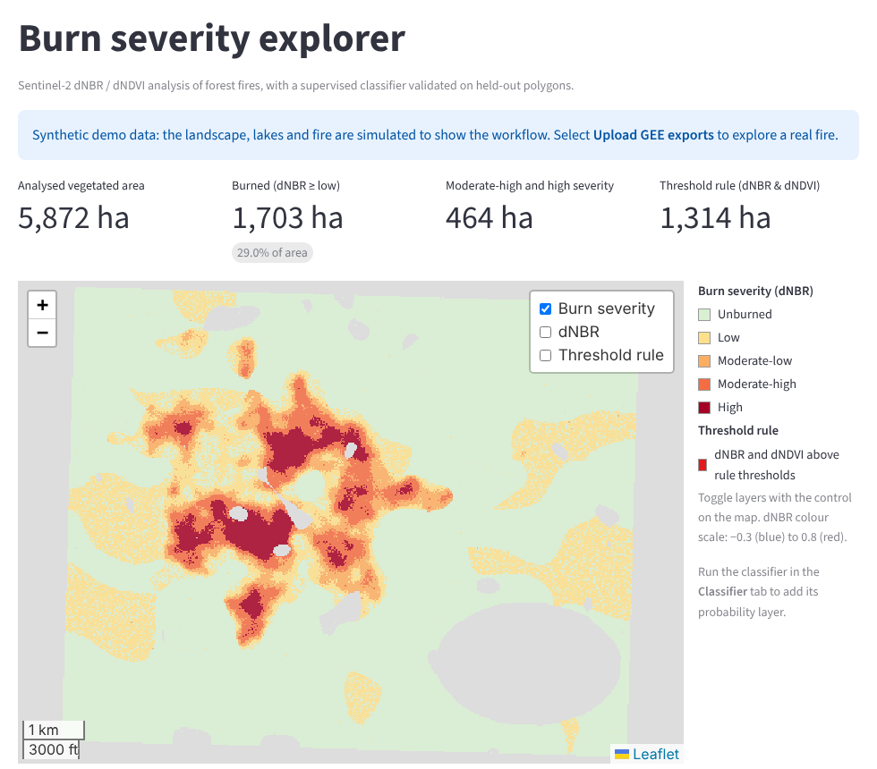
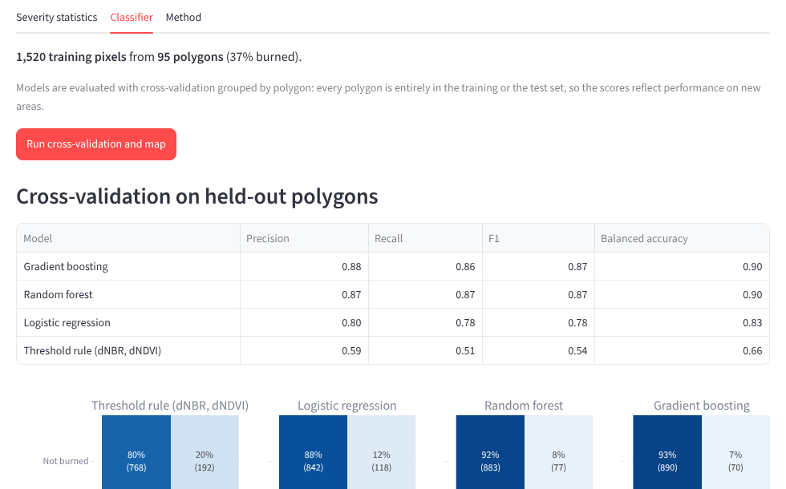
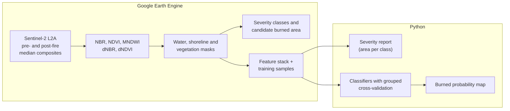
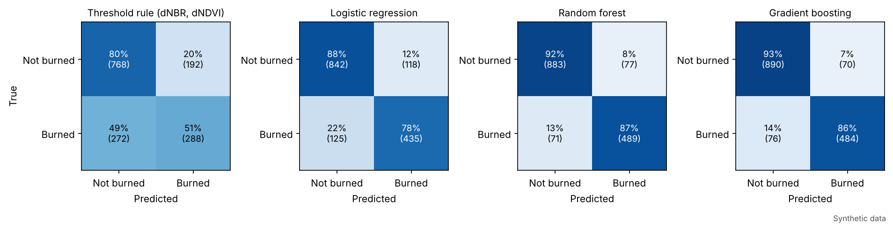
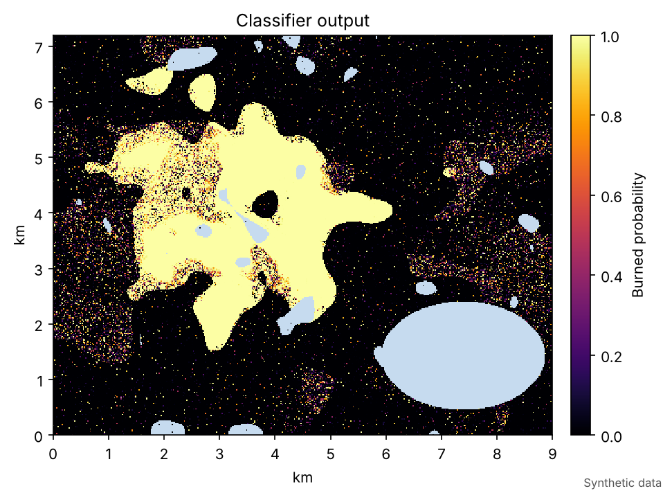
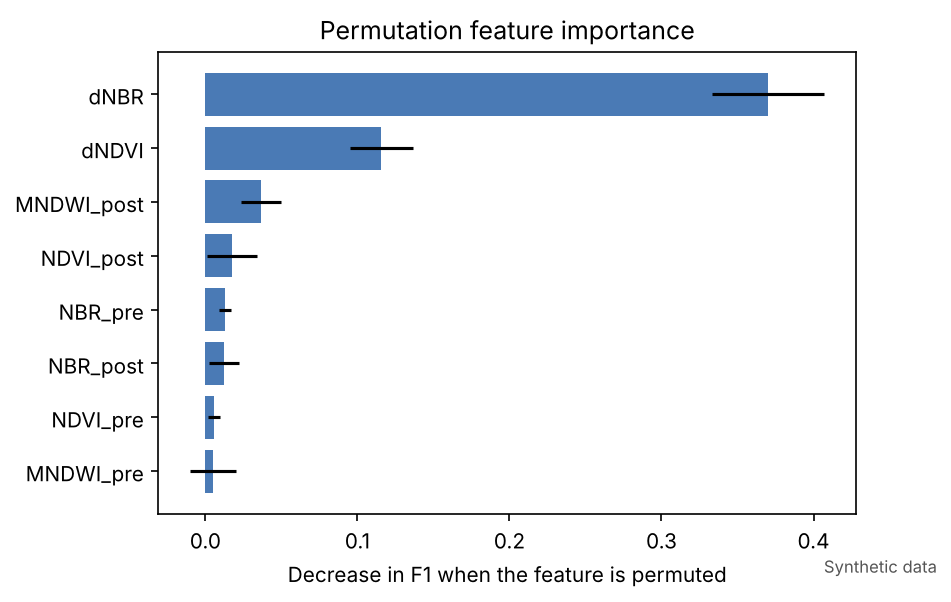

# Burn severity and burned-area mapping with Sentinel-2 and machine learning

Mapping of burned area and burn severity in Andean-Patagonian forests from Sentinel-2 imagery, combining a standard spectral index workflow in Google Earth Engine with a supervised classifier in Python.

The case study area lies between San Carlos de Bariloche and El Bolsón (Río Negro, Argentina), affected by forest fires in the 2025 summer season. The methods are generic and work for any region and fire event.



*Figures in this README are produced with the synthetic demo dataset included in the repository (see [Demo](#demo)).*

## Interactive app

`streamlit_app.py` is a web app to explore the results without writing code:

- **Map** with burn severity, dNBR, the threshold rule and the classifier probability as switchable layers over satellite imagery.
- **Live parameters**: change the vegetation and water masks, the severity limits and the threshold rule from the sidebar, and every map, area and chart updates.
- **Severity statistics**: area per class (downloadable as CSV), dNBR histogram and the dNBR–dNDVI change space with the threshold rule.
- **Classifier**: trains and compares the models with polygon-grouped cross-validation, shows confusion matrices and feature importance, and adds the burned probability to the map.
- **Data**: runs on the synthetic demo by default; GEE exports can be uploaded directly in the sidebar or placed in `data/raw/`.

```bash
pip install -e ".[app]"
streamlit run streamlit_app.py
```

To publish it, push the repository to GitHub and create an app on [Streamlit Community Cloud](https://streamlit.io/cloud) pointing to `streamlit_app.py` (dependencies are read from `requirements.txt`).



## Workflow



## Methods

**Sentinel-2 composites.** Surface reflectance (`COPERNICUS/S2_SR_HARMONIZED`) for a pre-fire and a post-fire window, with clouds, cloud shadows, cirrus, snow and defective pixels removed using the Scene Classification Layer, and combined into median composites.

**Spectral indices.**
- NBR = (NIR − SWIR2) / (NIR + SWIR2), using B8A and B12: sensitive to the loss of green vegetation and the exposure of charred soil.
- NDVI = (NIR − Red) / (NIR + Red), using B8 and B4: vegetation greenness.
- MNDWI = (Green − SWIR1) / (Green + SWIR1), using B3 and B11: open water detection.
- dNBR and dNDVI: pre-fire minus post-fire values.

**Masks.** Water is identified with the scene classification or MNDWI, before or after the fire, and a shoreline buffer is excluded to avoid mixed land-water pixels. The analysis is restricted to pixels vegetated before the fire (pre-fire NDVI > 0.2).

**Severity and candidate burned area.** dNBR is grouped into the severity classes of Key & Benson (2006): unburned (< 0.10), low (0.10–0.27), moderate-low (0.27–0.44), moderate-high (0.44–0.66) and high (≥ 0.66). Candidate burned pixels are those where both dNBR and dNDVI exceed 0.10.

**Supervised classification.** A fixed threshold confuses fire with other causes of vegetation loss, such as the summer drying of grasslands and shrublands, and misses low-severity burns. Labelled polygons of burned and unburned areas are sampled on the feature stack and used to train logistic regression, random forest and gradient boosting classifiers, which are compared with the threshold rule.

- **Grouped cross-validation.** Pixels from the same polygon are almost identical, so a random pixel split would leak information between training and test sets and inflate accuracy. Folds are built by polygon (`StratifiedGroupKFold`): every polygon is entirely in the training or in the test set.
- **Permutation importance** is computed on held-out polygons to show which indices drive the predictions.
- The best model is refitted on all samples and applied to every pixel to produce a burned probability map.

## Demo

The repository includes a synthetic scene (9 × 7 km at 20 m) with forest, shrubland, grassland, bare ground and lakes, a fire with a severity gradient, and summer drying of grasslands that also lowers NBR and NDVI. Because the true burned area is known, the maps can be checked against it.

**Cross-validation on held-out polygons** (mean ± sd over 5 folds):

| Method | Precision | Recall | F1 | Balanced accuracy |
|---|---|---|---|---|
| Gradient boosting | 0.88 ± 0.05 | 0.86 ± 0.09 | 0.87 ± 0.04 | 0.90 ± 0.04 |
| Random forest | 0.87 ± 0.05 | 0.87 ± 0.09 | 0.87 ± 0.05 | 0.90 ± 0.04 |
| Logistic regression | 0.80 ± 0.07 | 0.78 ± 0.11 | 0.78 ± 0.06 | 0.83 ± 0.04 |
| Threshold rule (dNBR, dNDVI) | 0.59 ± 0.10 | 0.51 ± 0.19 | 0.54 ± 0.15 | 0.66 ± 0.08 |



**Map-level check against the synthetic ground truth** (1,209 ha burned):

| Method | Burned area (ha) | Burned pixels detected | Dry vegetation flagged as burned |
|---|---|---|---|
| Threshold rule | 1,314 | 69% | 60% |
| Gradient boosting (p > 0.5) | 1,311 | 93% | 14% |

Both methods give almost the same total area, but for different reasons: the threshold rule misses about a third of the burned pixels and compensates by flagging most of the dry vegetation. A correct total does not imply a correct map.



**Lesson from building the demo.** In a first version, the training polygons did not include unburned grassland. The classifier then labelled 86% of unburned grassland as burned, because the only grassland-like pixels it had seen were low-severity burns. Training polygons need to cover every land cover in the scene, not only the burned area and the dominant forest.



## Repository structure

```
├── gee/
│   └── burn_severity_s2.js         # composites, indices, masks, severity, exports
├── streamlit_app.py                # interactive app
├── burnmap/                        # Python package
│   ├── config.py                   # parameters
│   ├── raster.py                   # GeoTIFF reading and writing
│   ├── severity.py                 # dNBR classes, area per class, analysis mask
│   ├── classifier.py               # models, grouped CV, permutation importance, raster prediction
│   ├── mapping.py                  # reprojection and colouring for web maps
│   ├── demo.py                     # synthetic scene generator
│   └── plots.py                    # figures
├── scripts/
│   ├── make_demo_data.py           # synthetic scene and training samples
│   ├── severity_report.py          # area per severity class, maps
│   ├── train_classifier.py         # model comparison and burned probability map
│   └── evaluate_demo_truth.py      # demo only: comparison with the synthetic truth
├── tests/                          # unit and app tests (pytest)
├── data/                           # inputs (see data/README.md)
├── docs/img/                       # README figures
└── requirements.txt                # dependencies for Streamlit Community Cloud
```

## Quick start

```bash
pip install -e ".[dev]"

# Interactive app
streamlit run streamlit_app.py

# Demo with synthetic data (outputs in demo_output/)
python scripts/make_demo_data.py
python scripts/severity_report.py --demo
python scripts/train_classifier.py --demo
python scripts/evaluate_demo_truth.py

# Tests
pytest
```

## Running on real data

1. **Google Earth Engine.** Open `gee/burn_severity_s2.js` in the Code Editor and draw or import the study area as `ROI`. Set the pre- and post-fire windows in `params`: the pre-fire window must end before the fire starts, and the post-fire window should start once the fire is contained.
2. **Training polygons (optional, for the classifier).** Draw polygons as a FeatureCollection named `TRAINING` with a numeric property `class` (1 = burned, 0 = not burned). The post-fire SWIR composite layer helps to identify burned areas. Include every land cover in the scene: burned areas of different severity, unburned forest, shrubland, grassland, dry vegetation and bare ground, spread across the study area.
3. **Exports.** Run the script and launch the exports from the *Tasks* tab. Save `burn_features.tif` and `burn_training_samples.csv` in `data/raw/`.
4. **Python.** Explore the exports in the app (upload them in the sidebar, or keep them in `data/raw/` and select *Local files*), or run the scripts:

```bash
python scripts/severity_report.py
python scripts/train_classifier.py
```

### Main parameters

| Parameter | Where | Default | Description |
|---|---|---|---|
| `startPre`, `endPre` | GEE | 2025-01-01 to 2025-01-29 | Pre-fire window |
| `startPost`, `endPost` | GEE | 2025-02-15 to 2025-03-15 | Post-fire window |
| `mndwiWater` | GEE | 0.10 | MNDWI threshold for water |
| `shoreBufferM` | GEE | 40 m | Excluded distance around water |
| `ndviMin` | GEE / `SEVERITY` | 0.20 | Minimum pre-fire NDVI |
| `dnbrMin`, `dndviMin` | GEE / `BASELINE` | 0.10 | Threshold rule |
| `minPatchPixels` | GEE | 0 (off) | Minimum size of candidate burned patches |
| `thresholds` | `SEVERITY` | 0.10, 0.27, 0.44, 0.66 | dNBR severity class limits |
| `n_splits` | `CLASSIFIER` | 5 | Cross-validation folds |

## Outputs

| File | Content |
|---|---|
| `results/severity_area_ha.csv` | Pixels, area (ha) and share of each severity class |
| `results/cv_summary.csv`, `cv_scores_by_fold.csv` | Cross-validation metrics per model |
| `results/feature_importance.csv` | Permutation importance of the best model |
| `results/burned_probability.tif` | Burned probability per pixel (GeoTIFF) |
| `results/burned_area_by_method.csv` | Burned area from the threshold rule and the classifier |
| `figures/*.png` | Severity map, dNBR histogram, confusion matrices, feature importance, probability map |

## References

- Key, C.H. & Benson, N.C. (2006). Landscape Assessment: Ground measure of severity, the Composite Burn Index; and remote sensing of severity, the Normalized Burn Ratio. In *FIREMON: Fire Effects Monitoring and Inventory System*. USDA Forest Service, RMRS-GTR-164-CD.
- Xu, H. (2006). Modification of normalised difference water index (NDWI) to enhance open water features in remotely sensed imagery. *International Journal of Remote Sensing*, 27(14), 3025–3033.

## Author

**Lucía Gabriela De Stefano**, PhD in Biological Sciences. Researcher in aquatic ecology and remote sensing, Bariloche, Argentina. [LinkedIn](https://www.linkedin.com/in/luciagdestefano/)

## License

[MIT](LICENSE)
